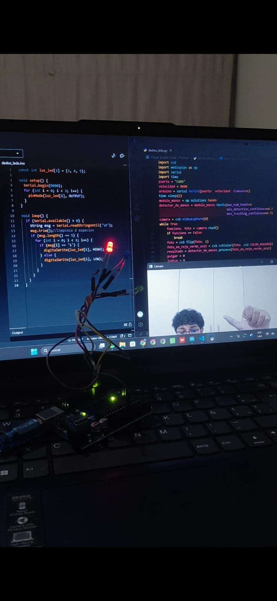
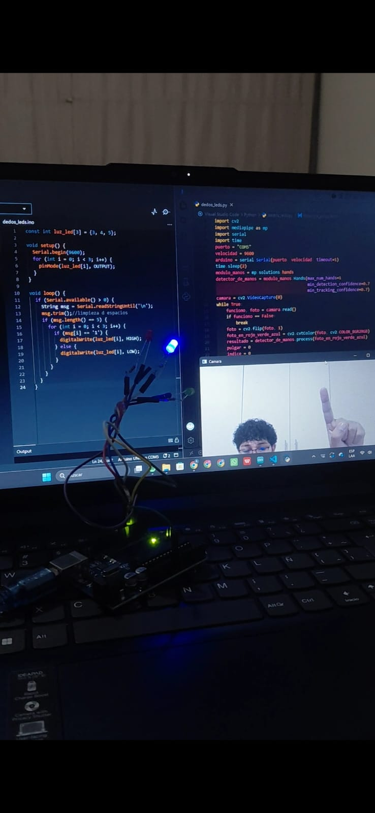
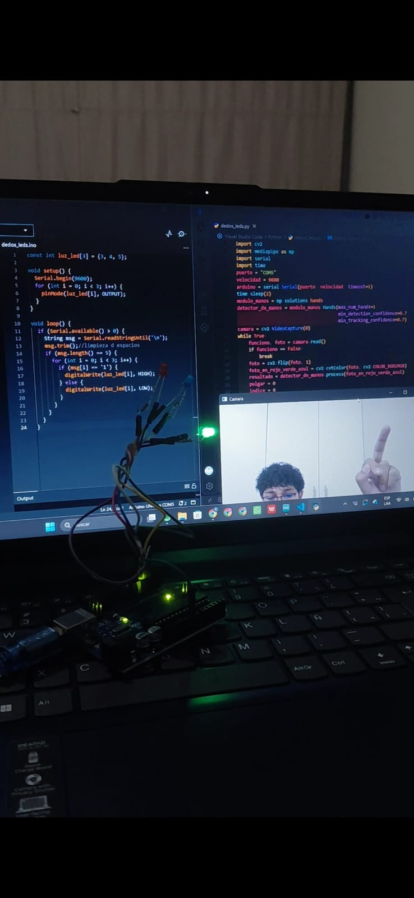
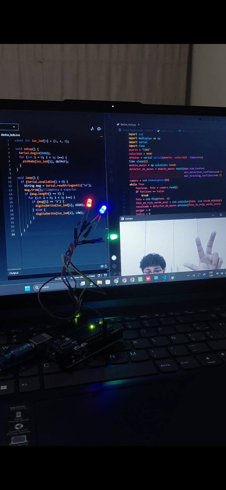

# finger-counter-arduino-leds

Conteo de dedos en tiempo real con Python, OpenCV y MediaPipe, controlando LEDs en un Arduino por comunicación serial.






## Cómo funciona
1. Python detecta la mano con MediaPipe y cuenta los dedos levantados.
2. El resultado se envía al Arduino por el puerto serial.
3. El Arduino enciende los LEDs correspondientes.

## Tecnologías
Python, OpenCV, MediaPipe, PySerial, Arduino

## Hardware
- Arduino UNO
- 3 LEDs (pines 3, 4 y 5)
- Cámara web

## Cómo ejecutarlo
1. Carga `dedos_leds.ino` en el Arduino.
2. Instala las dependencias y ejecuta el script:

```
pip install -r requirements.txt
python dedos_leds.py
```

Cambia el puerto `COM5` en `dedos_leds.py` por el de tu Arduino.
